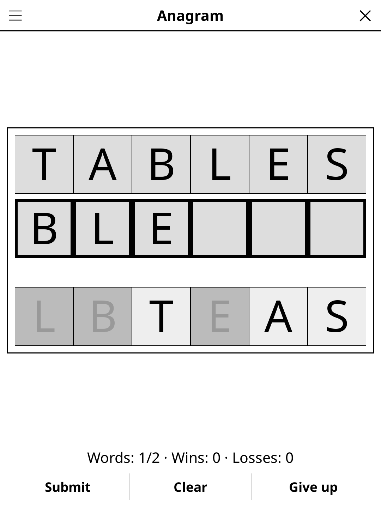

# anagram.koplugin

A word anagram puzzle plugin for [KOReader](https://github.com/koreader/koreader).

## Screenshot

## Rules

Rearrange the scrambled letters to form a valid word, using every letter exactly once. Some letters make several words: there is one answer row per word to find, and the round is won once every row is filled. Tap a tile at the bottom to add it to your answer, tap a letter in the answer to give it back, and submit.

## Features

- **Large word dictionary** — English and French word lists
- **One row per word** — STABLE and TABLES make two rows; every real word that uses all the letters fills one
- **No penalty for a wrong guess** — the letters go back and you try again; **Give up** shows the missed words and counts a loss
- **Clean word lists** — no proper nouns, abbreviations or vulgar words
- **No repeats** — the puzzles already played are remembered (STABLE played means no TABLES either): a word only comes back once about 3,000 others have been played, in solo and multiplayer alike
- **Auto-save** — current puzzle restored on next launch

## Multiplayer

**Anagram · multiplayer** (Tools → Games → Party & quiz, or **Mode** in the
game's menu) turns the reader into the board of a shouting game: lay it in
the middle of the table, the scrambled letters fill the screen, and the first
player to shout a real word using every letter wins it.

- Tap **Answer** when someone shouts (or let the timer run out): every word
  the letters make is shown, then tap the finder's name, or **Nobody**.
- A word is worth its length minus 3: 4 letters = 1 point … 7 letters = 4.
- Menu: **Players**, **Player names** (remembered), **Words** per match (5–20),
  **Timer** per word (off, 30 s – 2 min), **Language**, **Length**, **Scores**.
- **Shuffle** mixes the letters again. After the last word: the final
  scoreboard, and **New game**. A match in progress is saved and restored,
  separately from the solo game.

## Installation

1. Download `anagram.koplugin.zip` from the [latest release](../../releases/latest).
2. Extract into the `plugins/` folder of your KOReader data directory.
3. Restart KOReader.
4. Open the menu → **Tools** → **Anagram**.

## Controls

| Action | How |
|--------|-----|
| Add letter to answer | Tap a tile (bottom row) |
| Return letter to the tiles | Tap the letter in the answer row |
| Submit answer | Tap **Submit** |
| Give up | Tap **Give up** |
| Next puzzle | Tap **Next word** once the round is over, or **New game** in the menu |
| Show rules | Tap **Rules** |

## License

GPL-3.0 — see [LICENSE](LICENSE).
